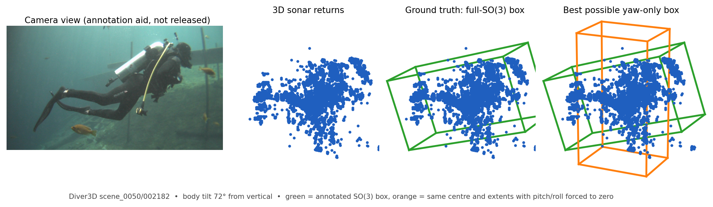
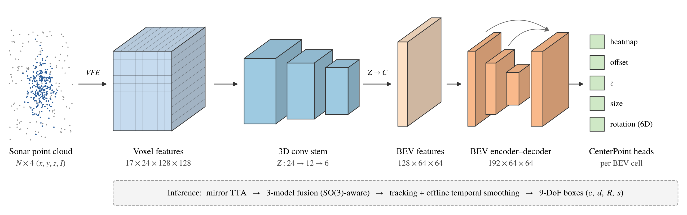
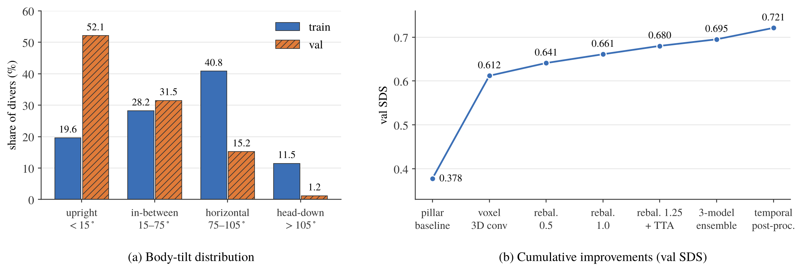
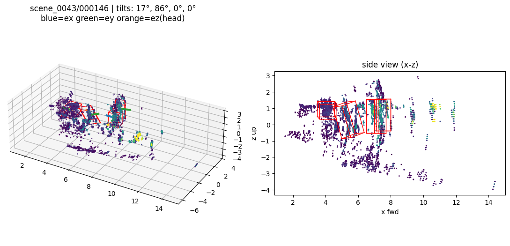

# Voxel CenterPoint with Pose Rebalancing for 3D Sonar Diver Detection

Our entry to the [MaCVi 2027 Diver3D challenge](https://macvi.org/workshop/macvi27/challenges/diver3d) (WACV 2027 workshop), ranked **6th of 15 teams**.

  

<b>Figure 1.</b> A diver tilted 72° from vertical. The sonar returns (blue) only fit a box with full SO(3) rotation (green). A yaw-only box with the same center and extents (orange) misses most of the body, which is why we regress the full rotation.

## Overview

Diver3D asks for every diver in a 3D imaging-sonar point cloud as a 9-DoF box: center, size and full rotation. The ranking metric, SDS, weights 3D detection three times as heavily as translation, size and orientation error:

$$\mathrm{SDS} = \tfrac{1}{6}\big(3\,\mathrm{mAP_{3D}} + (1-\mathrm{ATE}) + (1-\mathrm{ASE}) + (1-\mathrm{AOE_{3D}}/90^\circ)\big)$$

Our pipeline is a single-stage voxel detector in the style of CenterPoint, trained from scratch on the train split. Three choices account for most of its performance:
- a 3D convolutional stem that keeps vertical structure;
- a 6D rotation head trained with a loss that respects the metric's symmetry;
- sampling that corrects a large train/test shift in diver pose.

At inference, mirror test-time augmentation, a three-model ensemble and non-learned temporal smoothing add further gains.

## Method

  

<b>Figure 2.</b> Architecture. Points are voxelized at 0.1 × 0.1 × 0.25 m. A dense 3D conv stem reduces height from 24 to 6 bins before it is folded into channels, then a 2D encoder–decoder produces a 64 × 64 BEV map (0.2 m cells) with CenterPoint-style heads.

**Rotation.** The head predicts two vectors that are orthonormalized by Gram–Schmidt with the head axis first, so tilt and head-up direction are never traded against the chest direction. We train with a symmetric chordal loss, min over {I, Rz(π)} of ‖R̂ − R·S‖². It has the same minimizer as the metric's geodesic angle, smooth gradients near zero, and no penalty for the one symmetry the metric leaves free.

**Pose rebalancing.** Training divers are mostly horizontal, while validation and test divers are mostly upright (Fig. 3a). We reweight training frames and pasted divers by body tilt toward the validation distribution. This is the largest single improvement after the 3D stem.

**Augmentation.** Real divers are pasted from other frames with a curriculum, up to four per frame, decaying to one. Each is rotated about the sonar origin so its range and viewing aspect stay physically plausible. We add y-mirroring with the reflection-consistent box transform R′ = MRM, small yaw and scale changes, point dropout and intensity jitter.

**Inference.** Each model also runs on the mirrored cloud, and boxes from three models are fused with score-weighted centers and sizes and a chordal rotation mean after symmetry alignment. Detections are then linked into tracks and smoothed offline in center, rotation and size, and scores are blended with their track's mean. These steps contain no learned parameters; their hyperparameters were tuned on val and kept only if they improved both halves of the val scenes.

## Results

  

<b>Figure 3.</b> (a) Train is dominated by horizontal divers, val (and test) by upright ones. (b) Validation SDS after each stage, scored with the official evaluation code.

**Post-processing ablation** (val, on the 3-model ensemble)

| | SDS | Δ |
|---|---|---|
| Ensemble + mirror TTA | 0.695 | – |
| + center smoothing (σ = 1 frame) | 0.697 | +0.002 |
| + rotation smoothing (σ = 2) | 0.701 | +0.004 |
| + size smoothing (σ = 10) | 0.708 | +0.007 |
| + track-based rescoring (α = 0.5) | **0.721** | +0.014 |

## Qualitative examples

  

  

<b>Figure 4.</b> Top: a validation sequence with ground-truth boxes (left, top view; right, side view). Bottom: a frame with four divers and their body axes (chest normal, shoulder axis, head axis).

## Repository

| Notebook | Contents |
|---|---|
| [`00_baseline_pillar_visuals`](notebooks/00_baseline_pillar_visuals.ipynb) | Data exploration, visualizations, pillar BEV baseline |
| [`01_conventions_tests_data_report`](notebooks/01_conventions_tests_data_report.ipynb) | Unit tests for coordinate and rotation conventions, checks against the official scorer, metric sensitivity, dataset statistics |
| [`02_train_voxel_models_BC`](notebooks/02_train_voxel_models_BC.ipynb) | Voxel model; trains two configurations in parallel |
| [`03_train_FG_tta_ensemble`](notebooks/03_train_FG_tta_ensemble.ipynb) | Two more models, mirror TTA, ensemble selection |
| [`04_tune_postproc_submission`](notebooks/04_tune_postproc_submission.ipynb) | Temporal post-processing and submission files |

Each notebook writes its own `d3` package with `%%writefile` cells and runs on its own. Experiments ran on Kaggle with two T4 GPUs. One 20-epoch model trains in about 2.7 h (two in parallel), and post-processing runs on CPU. The dataset is not included; it is available from the challenge organizers.

## Challenge compliance

Models were trained from scratch on the train split only, with no external data or pretraining. Validation labels were used only for model selection, hyperparameter tuning and the pose-reweighting statistics. Validation and test point clouds were never used for training.

## Acknowledgements

Dataset, metric and evaluation code by the MaCVi 2027 Diver3D organizers. The detector design follows CenterPoint (Yin et al., CVPR 2021) and the SonarVoxNet challenge paper.
