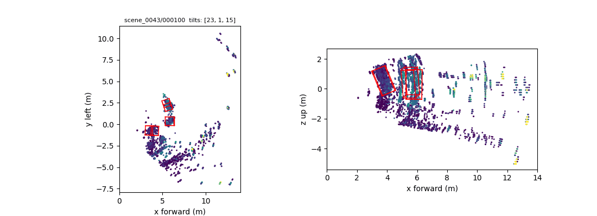
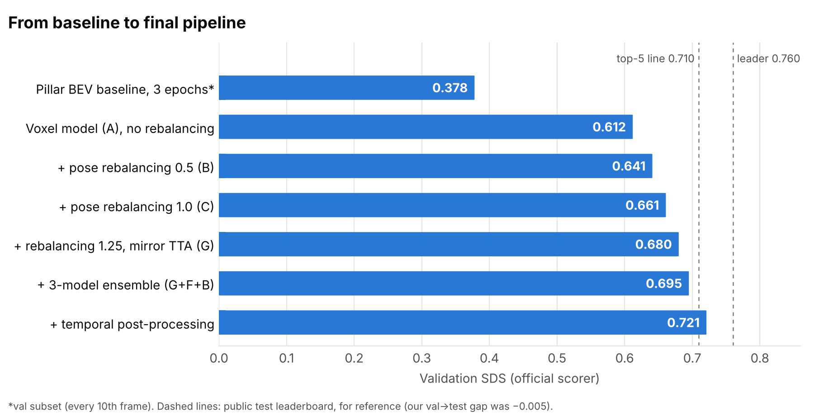
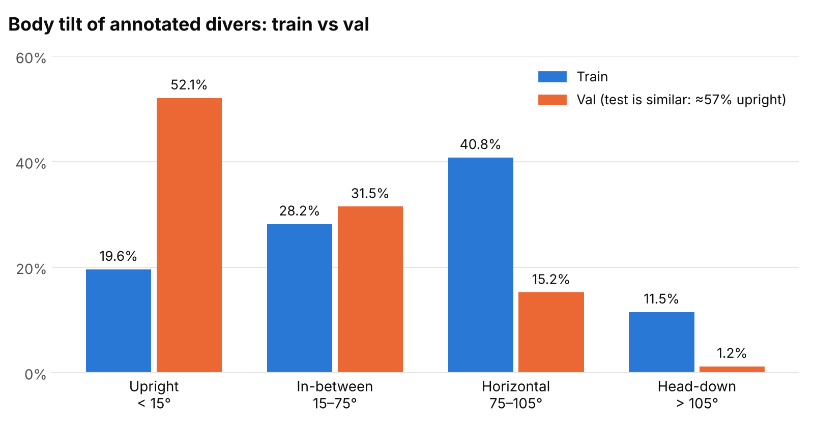

# Diver3D: 3D Sonar Diver Detection

Detecting scuba divers as full **9-DoF oriented 3D boxes** in imaging-sonar point clouds.
Entry to the [MaCVi 2027 Diver3D challenge](https://macvi.org/workshop/macvi27/challenges/diver3d) (WACV 2027 workshop).



| | Val SDS | Test SDS |
|---|---|---|
| Pillar baseline | 0.378 | – |
| Best single model (C) | 0.661 | **0.656** |
| Final pipeline: 3-model ensemble + temporal post-processing | **0.721** | – * |

<sub>* The full pipeline finished after the submission deadline. Val tracked test closely (−0.005 for model C).</sub>

---

## The task

Each frame is a sonar point cloud of `(x, y, z, intensity)`. Every diver must be predicted as a center, a size (length, width, height) and a full rotation in SO(3), with a confidence score.

The ranking metric, **SDS**, blends detection quality and pose accuracy:

```
SDS = ( 3·mAP3D + (1 − ATE) + (1 − ASE) + (1 − AOE3D/90°) ) / 6
```

mAP3D counts three times, so finding divers with tight 3D boxes matters most. Rotation is scored with one free symmetry: turning a diver 180° about the head–feet axis is free, while swapping head and feet costs the full 180°.


## Pipeline


<picture>
  <source media="(prefers-color-scheme: dark)" srcset="assets/progress_dark.png">
  
</picture>

## What made the difference

**1. Keep the vertical structure.** The pillar baseline found divers from above (BEV AP 0.59) but got their 3D boxes wrong, because it collapsed height before learning anything. A voxel grid with 3D convolutions that fold height into channels lifted val SDS from **0.378 to 0.612**.

**2. Rotation that matches the metric.** The rotation head predicts 6 numbers turned into a rotation by Gram–Schmidt, with the **head axis first**, so tilt and head-up are never compromised. The loss is a **symmetric chordal loss**, min over {I, Rz(π)}. It has the same optimum as the metric's angle but smooth gradients, and it never punishes the network for the free symmetry.

**3. Fix the pose shift.** Training data is mostly horizontal divers, while validation and test are mostly upright:

<picture>
  <source media="(prefers-color-scheme: dark)" srcset="assets/pose_shift_dark.png">
  
</picture>

Reweighting training frames and pasted divers by body tilt toward the val mix was the single most reliable gain: about **+0.06 SDS** (0.612 at rebalance 0 → 0.676 at 1.25, same architecture, no TTA).

**4. Augmentation.** Real divers are pasted from other frames with a curriculum (up to 4 per frame, decaying to 1). Each is rotated about the sonar origin so its range and viewing angle stay physical. Mirror, yaw, point-dropout and intensity jitter complete the set, and every box transform is unit-tested.

**5. Ensemble and temporal post-processing.** Mirror test-time augmentation, a forward-selected ensemble (G + F + B), then non-learned tracking with offline smoothing of center, rotation and size, plus track-based rescoring. A setting was kept only if val SDS improved on both halves of val:

| Step | Val SDS |
|---|---|
| Ensemble, untuned | 0.695 |
| + center smoothing | 0.697 |
| + rotation smoothing | 0.701 |
| + size smoothing | 0.708 |
| + track rescoring (fewer false positives in empty frames) | **0.721** |

## Notebooks

| Notebook | What it does |
|---|---|
| [`00_baseline_pillar_visuals`](notebooks/00_baseline_pillar_visuals.ipynb) | Data exploration, visualizations, pillar baseline |
| [`01_conventions_tests_data_report`](notebooks/01_conventions_tests_data_report.ipynb) | Unit tests for coordinate/rotation conventions, checks against the official scorer, metric sensitivity, data report |
| [`02_train_voxel_models_BC`](notebooks/02_train_voxel_models_BC.ipynb) | Voxel model; trains B and C in parallel on 2 GPUs |
| [`03_train_FG_tta_ensemble`](notebooks/03_train_FG_tta_ensemble.ipynb) | Trains F and G, mirror TTA for all models, ensemble selection |
| [`04_tune_postproc_submission`](notebooks/04_tune_postproc_submission.ipynb) | Temporal post-processing tuning and submission files |

Every notebook writes its own `d3` package with `%%writefile` cells, so each runs on its own. They were run on Kaggle (2× T4). One 20-epoch model takes about 2.7 h; post-processing runs on CPU.

## Rules followed

Trained on the train split only, from scratch, with no external data or pretraining. Val labels were used only for model selection, hyperparameter tuning and the pose-reweighting statistics. Post-processing is hand-designed and fits nothing on val or test point clouds.

## Acknowledgements

Dataset, metric and official scorer by the MaCVi 2027 Diver3D organizers. Architecture ideas follow CenterPoint and the SonarVoxNet challenge paper.
